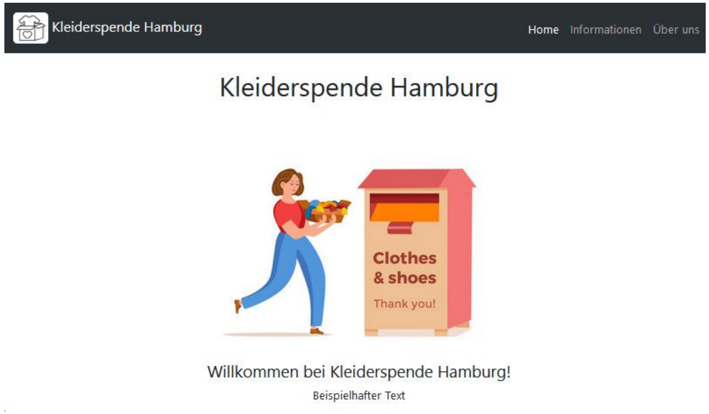
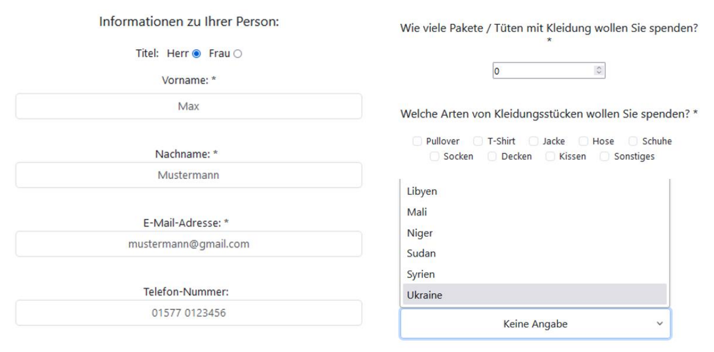
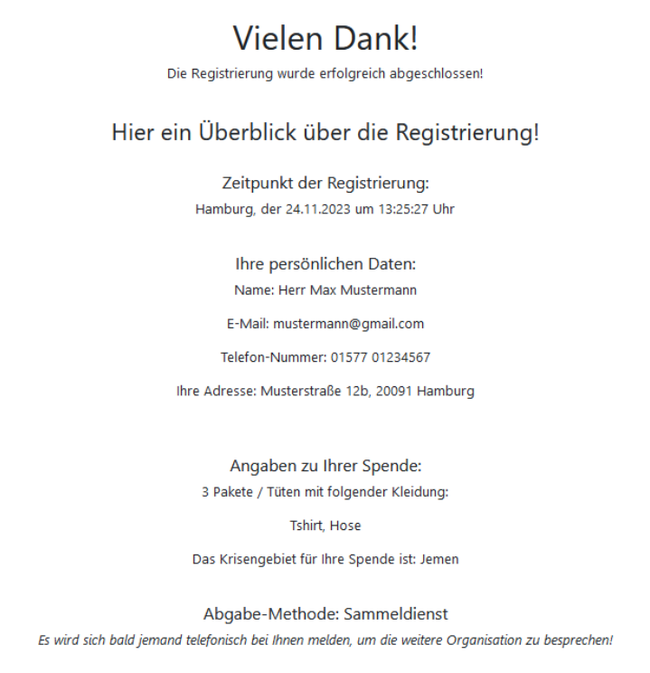
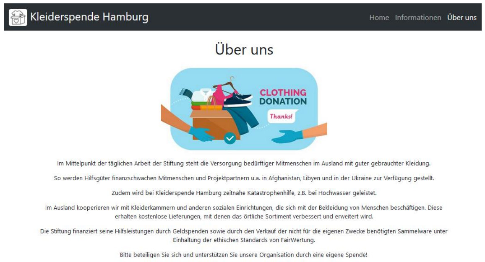

# Kleiderspende Hamburg

A website for a fictional non-profit organization that collects clothing donations for crisis regions. Donors register their donation through a form and can choose the crisis region and how the donation is handed over.

Case study from my Bachelor of Science in Computer Science at IU International University of Applied Sciences, module *Programming of Web Application Interfaces (IPWA01-01)*, November 2023. The project is a prototype and not meant for productive use.

  

## Features

- **Multi-page website** with header, navigation, content area and footer (pages: Home, Information, About us, privacy policy, imprint)
- **Registration form** for personal data, number of packages, types of clothing and crisis region
- **Two hand-over options:** pick-up by a collection vehicle or personal drop-off at the office. The form adapts to the choice.
- **Form validation** in the browser, e.g. required fields, patterns and at least one type of clothing. For pick-ups, the address must be in the office's area (the first two digits of the postcode must match).
- **Confirmation page** that shows the registration data after submitting
- **Responsive design** for desktop and mobile devices

## Screenshots

| Registration form | Confirmation page |
|:---:|:---:|
|  |  |

  

## Built with

- HTML5, CSS3 and JavaScript
- [Bootstrap](https://getbootstrap.com/) for layout and components
- Visual Studio Code and Git/GitHub

## Technical notes

- Data is passed from the form to the confirmation page with the browser's **Local Storage**.
- The confirmation page uses `.innerText` instead of `.innerHTML` to protect against **XSS**.

## Limitations

- The data is only stored in the browser. A real application would need a server and a database, and the form should send the data with `POST`.
- HTTPS and further server security would be needed for real use.

## Author

Jule Engel
